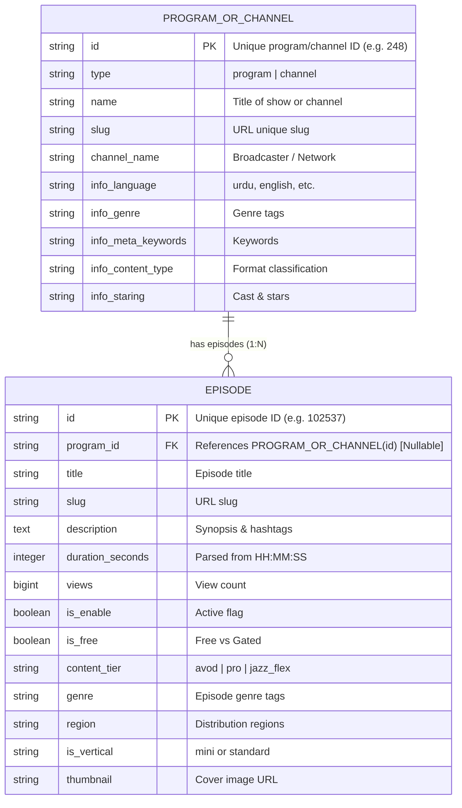

# ResearchRadar: CSV Data Dictionary & Schema Specification

**Document Version:** 1.0  
**Inspection Date:** 2026-10-26  
**Target Files:**  
- `data/prod_enrichment.csv` (97,842 bytes, 634 rows)
- `data/episodes_prod.csv` (6,668,620 bytes, 6,547 rows)

---

## 1. Executive Summary & Confirmed Relationship

Through byte-level and row-level inspection using non-destructive streaming analysis, the two CSV datasets represent a hierarchical **One-to-Many (1:N) Parent-Child Media Catalog**:

1. **`prod_enrichment.csv` defines Programs & Broadcast Channels (Parent Entities):**
   - 634 total rows, encoding: UTF-8 with BOM (`utf-8-sig`), delimiter: comma `,`.
   - Represents media series, TV shows, and channels (e.g., drama series like *Ehd E Wafa*, automotive reviews like *PakWheels Review*, talk shows, morning shows).
   - Primary key: `id` (634 unique, non-null integer values).
   - Natural unique key: `slug` (634 unique, non-null values).

2. **`episodes_prod.csv` defines Video Episodes & Content Items (Child Entities):**
   - 6,547 total rows, encoding: UTF-8 with BOM (`utf-8-sig`), delimiter: comma `,`.
   - Represents individual episodes, teasers, and video items.
   - Primary key: `id` (6,547 unique, non-null integer values).
   - Foreign key: `program_id` references `prod_enrichment.id`.
     - **Match rate:** 6,300 out of 6,547 rows (**96.23%**) directly match an existing program in `prod_enrichment.csv`.
     - **Unique programs linked:** 502 distinct `program_id` values match `prod_enrichment.id`.
     - **Unlinked programs:** 247 episodes (3.77%, across 212 distinct `program_id` values) reference program IDs not present in the current `prod_enrichment.csv` export.
     - **Conservative treatment:** `episodes.program_id` must be a nullable foreign key (`ondelete="SET NULL"`) with an index to safely accommodate un-enriched legacy or standalone episodes without rejecting valid records.

---

## 2. Dataset 1: `prod_enrichment.csv` Specification

- **Total Rows:** 634
- **Encoding:** UTF-8 with BOM (`utf-8-sig`)
- **Delimiter:** `,` (comma)
- **Primary Key:** `id` (integer)
- **Natural Unique Key:** `slug` (string)

### Column-by-Column Analysis

| Column Name | Inferred Data Type | Null / Empty % | Required / Optional | Candidate Key? | Searchable | Filterable | Sortable | Displayed | Description & Representative Values |
|---|---|---|---|---|---|---|---|---|---|
| `type` | String(32) | 0.0% (0) | Required | No | No | Yes | Yes | Yes | Entity type discriminator: `'program'` (606 rows), `'channel'` (28 rows). |
| `id` | String(64) / BigInt | 0.0% (0) | Required | **Primary Key** | No | Yes | Yes | Yes | Unique identifier for program or channel (e.g. `248`, `1051`, `100075`). |
| `name` | String(255) | 0.0% (0) | Required | No (632 unique) | **Yes** (P1) | No | Yes | Yes | Program/Channel title (e.g. `"Ehd E Wafa"`, `"Aaj Pakistan"`, `"Honda Civic RS Turbo - PakWheels Review"`). |
| `slug` | String(255) | 0.0% (0) | Required | **Unique** | Yes | No | No | Yes | URL-safe slug (e.g. `"ehd-e-wafa"`, `"aaj-pakistan"`). |
| `channel_name` | String(255) | 20.66% (131) | Optional | No | Yes (P3) | **Yes** | Yes | Yes | Broadcast network/channel (e.g. `"Tamasha Life HD"`, `"AAJ News"`, `"TV One"`, `"Tamasha Dramas"`). |
| `info_language` | String(64) | 9.94% (63) | Optional | No | Yes | **Yes** | Yes | Yes | Audio/metadata language (e.g. `"urdu"`, `"english"`, `"arabic"`, `"russian"`, `"sindhi"`). |
| `info_genre` | String(255) | 20.19% (128) | Optional | No | Yes (P2) | **Yes** | No | Yes | Genre classifications, comma-separated (e.g. `"sports"`, `"automotive, reviews"`, `"romance, comedy"`, `"entertainment"`). Split into tag array for search/faceting. |
| `info_meta_keywords` | Text | 28.71% (182) | Optional | No | **Yes** (P2) | No | No | Yes | Search keyword tags (e.g. `"tamasha, pakistani drama"`, `"pakwheels, car review"`, `"ispr, military, army"`). |
| `info_content_type` | String(128) | 30.44% (193) | Optional | No | Yes | **Yes** | No | Yes | Content format taxonomy (e.g. `"drama"`, `"documentary, short film"`, `"talk show, morning show, tv show"`, `"trailer, promo, teaser"`). |
| `info_staring` | Text | 69.09% (438) | Optional | No | **Yes** (P2) | No | No | Yes | Cast, actors, hosts, or presenters (e.g. `"Ahad Raza Mir, Osman Khalid Butt, Ahmed Ali Akbar, Wahaj Ali"`, `"Suneel Munj"`). |

---

## 3. Dataset 2: `episodes_prod.csv` Specification

- **Total Rows:** 6,547
- **Encoding:** UTF-8 with BOM (`utf-8-sig`)
- **Delimiter:** `,` (comma)
- **Primary Key:** `id` (integer)
- **Foreign Key:** `program_id` -> `prod_enrichment.id`

### Column-by-Column Analysis (All 42 Columns)

| Column Name | Inferred Data Type | Null / Empty % | Required / Optional | Candidate Key? | Searchable | Filterable | Sortable | Displayed | Description & Representative Values |
|---|---|---|---|---|---|---|---|---|---|
| `id` | String(64) / BigInt | 0.0% (0) | Required | **Primary Key** | No | Yes | Yes | Yes | Unique episode ID (e.g. `102537`, `103414`). 6,547 unique values. |
| `program_id` | String(64) | 0.0% (0) | Required | Foreign Key | No | **Yes** | No | Yes | Parent program ID referencing `prod_enrichment.id`. (96.23% match). |
| `title` | String(255) | 0.0% (0) | Required | No | **Yes** (P1) | No | Yes | Yes | Full episode title (e.g. `"Muhabbat Khel Tamasha \| Teaser 3 \| TV One Drama"`). |
| `slug` | String(255) | 0.0% (0) | Required | No | Yes | No | No | Yes | URL-friendly episode slug (e.g. `"muhabbat-khel-tamasha-teaser-3-tv-one-drama"`). |
| `description` | Text | 28.67% (1,877) | Optional | No | **Yes** (P3) | No | No | Yes | Multiline synopsis, summary, and hashtags (up to 1,049 chars). |
| `episode_number` | Integer / String | 100.0% (6,547) | Optional | No | No | No | No | No | 100% empty in current export. Retained in DB schema as nullable Integer. |
| `duration` | String(16) | 0.98% (64) | Optional | No | No | No | Yes | Yes | Duration in `"HH:MM:SS"` format (e.g. `"00:45:06"`, `"00:00:35"`). Converted to seconds integer for numeric sorting/filtering. |
| `views` | Integer / BigInt | 0.0% (0) | Required | No | No | **Yes** | **Yes** | Yes | Episode view count (e.g. `4573`, `23026`, `1249800`). Essential metric for sorting by popularity. |
| `is_enable` | Boolean | 0.0% (0) | Required | No | No | **Yes** | No | Yes | Enabled status (`"yes"` -> `True`). |
| `is_free` | Boolean | 0.0% (0) | Required | No | No | **Yes** | No | Yes | Free to view flag (`1` -> `True`, `0` -> `False`). |
| `published_date` | DateTime | 100.0% (6,547) | Optional | No | No | No | No | No | 100% empty in current export. Preserved in DB as nullable DateTime. |
| `release_dt` | DateTime | 100.0% (6,547) | Optional | No | No | No | No | No | 100% empty in current export. Preserved in DB as nullable DateTime. |
| `expiry_dt` | DateTime | 100.0% (6,547) | Optional | No | No | No | No | No | 100% empty in current export. Preserved in DB as nullable DateTime. |
| `ad_tag_url_android` | Text | 38.25% (2,504) | Optional | No | No | No | No | No | Ad tag URL for Android client. Preserved in DB; excluded from search index. |
| `ad_tag_url_ios` | Text | 37.79% (2,474) | Optional | No | No | No | No | No | Ad tag URL for iOS client. Preserved in DB; excluded from search index. |
| `channel_name` | String(255) | 100.0% (6,547) | Optional | No | No | No | No | No | 100% empty on episode; enriched from parent `prod_enrichment.channel_name`. |
| `channel_status` | Boolean | 0.0% (0) | Required | No | No | **Yes** | No | Yes | Channel status (`1` -> `True`, `0` -> `False`). |
| `content_rating` | String(64) | 100.0% (6,547) | Optional | No | No | No | No | No | 100% empty. Preserved in DB as nullable String. |
| `content_tier` | String(64) | 0.08% (5) | Optional | No | No | **Yes** | No | Yes | Access tier (e.g. `"avod"`, `"pro"`, `"jazz_flex"`). |
| `content_type` | String(64) | 100.0% (6,547) | Optional | No | No | No | No | No | 100% empty on episode; enriched from parent `prod_enrichment.info_content_type`. |
| `genre` | String(255) | 0.29% (19) | Optional | No | **Yes** (P2) | **Yes** | No | Yes | Genre string (e.g. `"Comedy"`, `"Web Shows & Series"`). |
| `hashtags` | Text | 100.0% (6,547) | Optional | No | No | No | No | No | 100% empty in dedicated column. Preserved in DB. |
| `insert_date` | DateTime | 100.0% (6,547) | Optional | No | No | No | No | No | 100% empty. Preserved in DB as nullable DateTime. |
| `is_corrupt` | Boolean | 100.0% (6,547) | Optional | No | No | No | No | No | 100% empty. Preserved in DB as nullable Boolean. |
| `is_latest` | Boolean | 100.0% (6,547) | Optional | No | No | No | No | No | 100% empty. Preserved in DB as nullable Boolean. |
| `is_migrate` | Boolean | 100.0% (6,547) | Optional | No | No | No | No | No | 100% empty. Preserved in DB as nullable Boolean. |
| `is_transcoded` | Boolean | 100.0% (6,547) | Optional | No | No | No | No | No | 100% empty. Preserved in DB as nullable Boolean. |
| `is_vertical` | String(32) | 96.75% (6,334) | Optional | No | No | **Yes** | No | Yes | `"mini"` (213 rows) for vertical/shorts format; null for standard video. |
| `is_zong_migrated` | Boolean | 100.0% (6,547) | Optional | No | No | No | No | No | 100% empty. Preserved in DB as nullable Boolean. |
| `keywords` | Text | 100.0% (6,547) | Optional | No | No | No | No | No | 100% empty in this column. |
| `manual_description`| Text | 100.0% (6,547) | Optional | No | No | No | No | No | 100% empty. |
| `meta_desc` | Text | 100.0% (6,547) | Optional | No | No | No | No | No | 100% empty. |
| `meta_keywords` | Text | 99.62% (6,522) | Optional | No | Yes | No | No | Yes | Keywords present on 25 rows. |
| `meta_title` | String(255) | 100.0% (6,547) | Optional | No | No | No | No | No | 100% empty. |
| `path` | String(500) | 100.0% (6,547) | Optional | No | No | No | No | No | 100% empty. |
| `popularity_rating` | Float | 100.0% (6,547) | Optional | No | No | No | No | No | 100% empty. |
| `region` | String(128) | 0.89% (58) | Optional | No | No | **Yes** | No | Yes | Geographical availability (e.g. `"DEFAULT"`, `"DEFAULT, GLOBAL"`, `"QATAR"`). |
| `source` | String(100) | 100.0% (6,547) | Optional | No | No | No | No | No | 100% empty. |
| `sourcerecord` | Text | 100.0% (6,547) | Optional | No | No | No | No | No | 100% empty. |
| `thumbnail` | String(500) | 0.0% (0) | Required | No | No | No | No | Yes | Thumbnail image URL (e.g. `https://images.mjunoon.tv:8181/mjunoon_images/...webp`). |
| `topic` | String(255) | 100.0% (6,547) | Optional | No | No | No | No | No | 100% empty. |
| `video_id` | String(64) | 100.0% (6,547) | Optional | No | No | No | No | No | 100% empty. |

---

## 4. Key Relationships & Data Integrity Strategy

### Relational Mapping Rules:
1. **Primary Join:** `episodes.program_id == programs.id`.
2. **Nullable Foreign Key:** In `episodes_prod.csv`, 247 episodes (3.77%) reference 212 program IDs that do not exist in `prod_enrichment.csv`. To ensure zero data loss:
   - In SQLite/Postgres, `program_id` is defined as `ForeignKey("programs.id", ondelete="SET NULL")` with `nullable=True`.
   - Episodes without a matching program are still ingested and indexed, retaining their original `program_id` in a dedicated column while leaving the ORM relation unpopulated.
3. **Enrichment Cascading to Search Index:**
   - When indexing an `episode` in Meilisearch, we denormalize parent program fields into the episode search document:
     - `program_name`: `program.name`
     - `channel_name`: `program.channel_name`
     - `language`: `program.info_language`
     - `stars`: `program.info_staring`
     - `program_content_type`: `program.info_content_type`
   - This allows users searching for an actor (e.g., *"Ahad Raza Mir"*), a channel (*"TV One"*), or a program (*"Ehd E Wafa"*) to find all relevant episodes and parent programs instantly.

---

## 5. Meilisearch Index Architecture

We establish **two distinct, high-performance Meilisearch indexes**:

1. **`episodes` Index:** Primary search entity for media discovery.
   - Primary key: `id`
   - Searchable attributes (in priority order):
     1. `title`
     2. `program_name`
     3. `stars`
     4. `genre`
     5. `description`
     6. `channel_name`
     7. `meta_keywords`
   - Filterable attributes:
     - `is_free`
     - `content_tier`
     - `genre`
     - `language`
     - `channel_name`
     - `region`
     - `is_vertical`
     - `program_id`
   - Sortable attributes:
     - `views`
     - `duration_seconds`
     - `title`

2. **`programs` Index:** Search index for browsing TV series, channels, and franchises.
   - Primary key: `id`
   - Searchable attributes (in priority order):
     1. `name`
     2. `info_staring`
     3. `info_genre`
     4. `channel_name`
     5. `info_meta_keywords`
     6. `info_content_type`
   - Filterable attributes:
     - `type` (`program` or `channel`)
     - `info_language`
     - `channel_name`
     - `info_content_type`
   - Sortable attributes:
     - `name`

---

## 6. Conservative Handling of Missing Values & Data Uncertainties

1. **Empty Columns:** 22 out of 42 columns in `episodes_prod.csv` are 100% empty in this production export. We preserve these columns in the canonical database table schema as nullable fields to guarantee forward-compatibility if future exports include populated values. However, they are excluded from search indexing and API responses to conserve memory and index size.
2. **Duration String Parsing:** Duration is formatted as `"HH:MM:SS"` (e.g. `"00:45:06"`). The ingestion pipeline safely parses this into `duration_seconds` (e.g. `2706` seconds) with fallback to `0` or `None` on parse error.
3. **Boolean Casting:**
   - `is_free`: numeric strings `"1"` -> `True`, `"0"` -> `False`.
   - `is_enable`: string `"yes"` -> `True`, else `False`.
   - `channel_status`: numeric strings `"1"` -> `True`, `"0"` -> `False`.
4. **Ad Tag URLs:** Ad URLs contain sensitive Google Ad Manager account IDs (`iu=/21622890900...`). These fields are strictly stored in the database but **never indexed in Meilisearch** or exposed to public search results.
