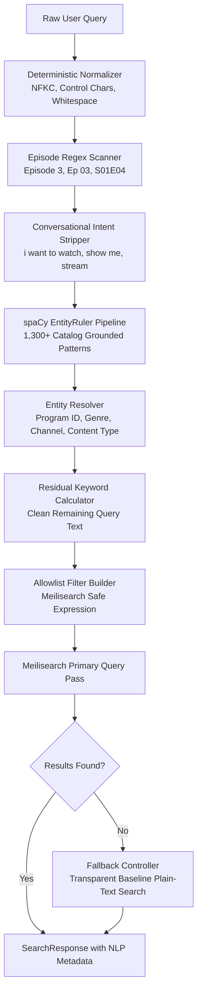

# CinePulse — spaCy NLP Query Understanding Architecture

## 1. Overview & Objectives

CinePulse features a lightweight, production-grade NLP query understanding and Named Entity Recognition (NER) pipeline built on **spaCy 3.8.x** and **en_core_web_sm**.

The objective of the NLP layer is to bridge natural, unstructured user input with structured catalog metadata in **Meilisearch**, enabling queries like:
- `"Ehd E Wafa Episode 3"` -> Exact Episode 3 of Ehd-E-Wafa via canonical `program_id` and `episode_number` filters.
- `"i want to watch funny movie"` -> Conversational intent stripping, mapping `"funny"` -> `genre_list: comedy` and `"movie"` -> `content_type: movie`, returning authentic comedy films.
- `"Hum News live"` -> Channel grounding on `channel_name: "Hum News"` without dangling keyword pollution.
- `"Pakistani drama"` -> Genre resolution (`genre_list: drama`) with national catalog discovery.

---

## 2. End-to-End Pipeline Data Flow

---

## 3. Core Components

### 3.1. Deterministic Normalizer (`app.services.nlp.normalization`)
- Unicode **NFKC** normalization to harmonize typographical variants.
- Standardization of curved quotes (`“`, `”`, `‘`, `’`) to standard ASCII quotes.
- Conversion of typographical dash variants (en-dash, em-dash, minus) to hyphen `-`.
- Stripping of non-printable control characters.
- Whitespace collapsing and canonical key formulation for zero-ambiguity dictionary lookup.

### 3.2. Catalog Knowledge Base (`app.services.nlp.catalog_entities`)
Extracts grounded metadata directly from SQLite during application startup:
- **`PROGRAM_TITLE`**: 632 distinct program titles and slug aliases.
- **`CHANNEL`**: 134 live broadcast channels (from `programs` where `type='channel'` and `episodes.channel_name`).
- **`GENRE`**: 95 catalog genres and semantic synonyms.
- **`CONTENT_TYPE`**: Format indicators (`movie`, `telefilm`, `short film`, `series`, `podcast`, `trailer`).
- **`LANGUAGE`**: Canonical media languages (`Urdu`, `English`, `Punjabi`, `Sindhi`, `Pashto`).
- **`PERSON`**: 344 lead cast and actor names.

### 3.3. Semantic Intent & Synonym Mapping
Conversational queries often use colloquial descriptors rather than formal catalog terms. The pipeline maps these deterministically:
- `"funny"`, `"hilarious"`, `"humor"`, `"jokes"` -> `GENRE: Comedy`
- `"scary"`, `"spooky"`, `"creepy"`, `"ghost"` -> `GENRE: Horror`
- `"romantic"`, `"love story"`, `"ishq"`, `"pyar"` -> `GENRE: Romance`
- `"action"`, `"thriller"`, `"suspense"`, `"fight"` -> `GENRE: Action`
- `"movie"`, `"film"`, `"cinema"` -> `CONTENT_TYPE: movie`
- `"kids"`, `"cartoons"`, `"animated"` -> `GENRE: Kids`

### 3.4. Query Parser (`app.services.nlp.query_parser`)
- Coordinates the regex scanners, conversational intent stripper, and spaCy doc processing.
- Computes character spans to cleanly excise recognized entities and conversational filler from `remaining_query`.
- Enforces strict query length bounds (default: 200 characters) to prevent CPU starvation.

### 3.5. Search Integration (`app.search.service`)
- Translates `QueryInterpretation` into safe Meilisearch expressions using allowlisted filter fields.
- Leverages `genre_list` array filtering so multi-genre programs (e.g. `horror, romance, comedy`) are accurately matched.
- Includes a **Zero-Hit Safe Fallback Controller**: if an assisted query combination yields 0 hits, the engine transparently re-executes using unassisted plain-text search, ensuring no content is erroneously hidden.

---

## 4. Hardware Constraints & Resource Budget

CinePulse is optimized for an **8GB RAM Windows host** operating strictly on **CPU**:
- Model footprint: `en_core_web_sm` (~45 MB RAM).
- Pattern footprint: 1,320 rules (~15 MB RAM).
- Lifespan singleton: loaded once on startup, zero per-request reloading overhead.
- Pipeline throughput: **p50 NLP latency of 12.7ms**, **p95 of 15.6ms**.
